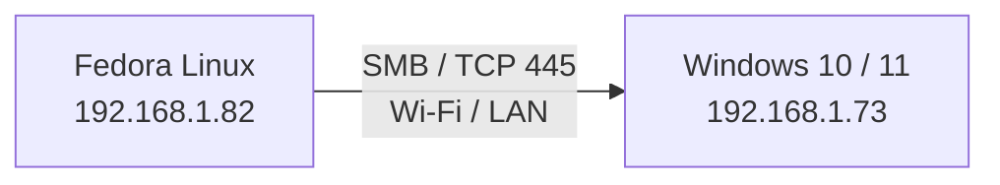

 # Fedora ↔ Windows File Sharing using Samba

A step-by-step guide to share files between a Fedora Linux computer and a Windows 10/11 computer over the same local Wi-Fi/LAN network.

**Tested setup in this guide:**
- Fedora computer username: `shamshad`
- Fedora shared folder: `/home/shamshad/Shared`
- Fedora LAN IPv4 address during setup: `192.168.1.82`
- Windows LAN IPv4 address during setup: `192.168.1.73`
- Samba share name: `Shared`

> **Important:** Your IP address may change when you reconnect to Wi-Fi. Replace `192.168.1.82` with the current Fedora LAN IP whenever necessary.

---

## 1. How it works

Samba lets Windows access a folder shared by Fedora using the SMB file-sharing protocol.



---

## 2. Prerequisites

- Both computers on the **same Wi-Fi/LAN network**.
- You have **sudo** access on Fedora.
- You have **administrator** access on Windows.

---

## 3. Step 1 — Install Samba on Fedora

Open a terminal on Fedora and run:

```bash
sudo dnf install samba samba-client -y
```

Enable and start the Samba service:

```bash
sudo systemctl enable --now smb nmb
```

Verify it is running:

```bash
sudo systemctl status smb
```

You should see `active (running)`.

---

## 4. Step 2 — Create the shared folder

Create the folder (if it doesn't already exist):

```bash
mkdir -p /home/shamshad/Shared
```

Set permissions so Samba can read/write it:

```bash
chmod 755 /home/shamshad/Shared
```

---

## 5. Step 3 — Configure the Samba share

Back up the original config first:

```bash
sudo cp /etc/samba/smb.conf /etc/samba/smb.conf.bak
```

Edit the config:

```bash
sudo nano /etc/samba/smb.conf
```

Add the following block at the **end** of the file:

```ini
[Shared]
   path = /home/shamshad/Shared
   browseable = yes
   read only = no
   guest ok = no
   valid users = shamshad
   create mask = 0664
   directory mask = 0775
```

> **Tip:** To allow guest (no password) access, set `guest ok = yes` and remove `valid users`. Password access is recommended.

Save and exit (`Ctrl+O`, `Enter`, `Ctrl+X` in nano).

Validate the config:

```bash
testparm
```

Press `Enter` to accept the default and check for errors.

---

## 6. Step 4 — Set a Samba password

Samba uses its own password database, separate from the Linux login password.

```bash
sudo smbpasswd -a shamshad
```

Enter and confirm a password. This is the password Windows will ask for.

Restart Samba to apply changes:

```bash
sudo systemctl restart smb nmb
```

---

## 7. Step 5 — Open the firewall

Allow SMB through Fedora's firewall:

```bash
sudo firewall-cmd --permanent --add-service=samba
sudo firewall-cmd --reload
```

Verify:

```bash
sudo firewall-cmd --list-services
```

You should see `samba` in the list.

---

## 8. Step 6 — Find the Fedora IP address

```bash
ip a
```

Look for the `inet` address on your Wi-Fi/Ethernet interface (e.g. `192.168.1.82`).

Quick one-liner:

```bash
hostname -I
```

---

## 9. Step 7 — Connect from Windows

### Option A — File Explorer address bar

1. Open **File Explorer**.
2. In the address bar, type:
   ```
   \\192.168.1.82\Shared
   ```
3. Press **Enter**.
4. When prompted, enter:
   - **Username:** `shamshad`
   - **Password:** the Samba password from Step 4.
5. Optionally check **Remember my credentials**.

### Option B — Map a network drive

1. Open **This PC** → **Map network drive**.
2. Choose a drive letter (e.g. `Z:`).
3. Folder: `\\192.168.1.82\Shared`
4. Check **Reconnect at sign-in**.
5. Click **Finish** and enter credentials.

The share should now appear and be readable/writable.

---

## 10. Troubleshooting

| Problem | Fix |
|---|---|
| Windows can't find the share | Ping Fedora: `ping 192.168.1.82` from Windows. Check both are on the same subnet. |
| Access denied | Re-run `sudo smbpasswd -a shamshad` and confirm the username matches `valid users`. |
| Connection refused | Ensure `smb` service is running and firewall allows `samba`. |
| IP changed after reconnect | Re-check `hostname -I` on Fedora and use the new IP. Consider setting a static DHCP lease. |
| Can't write files | Check folder ownership: `ls -ld /home/shamshad/Shared` and ensure `read only = no`. |
| Windows caches old credentials | Open **Credential Manager** → **Windows Credentials** → remove the old Samba entry. |

### Quick diagnostic commands (Fedora)

```bash
sudo systemctl status smb
sudo smbstatus
testparm
sudo journalctl -u smb -n 50
```

### Test the share locally (Fedora)

```bash
smbclient -L localhost -U shamshad
```

This lists shares and confirms Samba is responding.

---

## 11. Optional — Make the IP stable

To avoid updating the IP every time, either:

- Set a **static IP** on Fedora via NetworkManager, **or**
- Add a **DHCP reservation** for Fedora's MAC address in your router.

This keeps `\\192.168.1.82\Shared` working consistently.

---

## 12. Security notes

- Use password-protected shares (`guest ok = no`) on shared networks.
- Only share the specific folder needed — avoid sharing `/home/shamshad` entirely.
- Keep Fedora and Samba updated: `sudo dnf upgrade --refresh`.
- SMB is for **trusted LANs**; do not expose port 445 to the internet.

---

**Done!** Windows can now read and write to `/home/shamshad/Shared` on Fedora over SMB.
